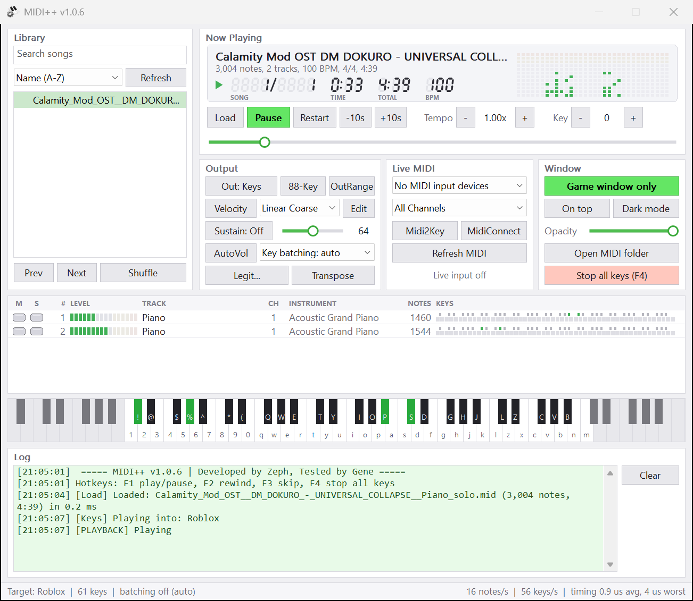

# MIDI++

**MIDI++** plays MIDI files, or a MIDI keyboard, into Roblox pianos and any app that reads the keyboard.

<picture>
  <source media="(prefers-color-scheme: dark)" srcset="docs/ui-dark.png">
  
</picture>

## Features
* **Every note lands:** held keys are released before they are pressed again, and notes that share a key (`t` and `T`) both play, even in one chord, and the longer one stays held.
* **Low latency:** a real-time playback thread with a high resolution timer, one SendInput per chord, new notes first.
* **Kernel streaming MIDI input** through KSMidi, with WinMM as a fallback.
* **Black MIDI:** 5 million notes load in about half a second and play on time.
* **Game window only:** switch to another app and every key is released and playback pauses. Clicking MIDI++ keeps the song going.
* **Outputs:** Keys (US positions, for Roblox), Typed (your keyboard layout) and MidiConnect.
* **Tempo, key, velocity curves, legit mode, mute and solo per track, light and dark theme.**
* **Auto-transpose:** finds the song's key and moves the game piano so more notes land on plain keys, while the song keeps its pitch. Turn it on with `AUTO_TRANSPOSE.ENABLED` in `config.json`.

## Quick Start
1. Download the latest release, unzip it and run `MIDI++.exe`.
2. Put `.mid` files in the `midi` folder and pick a song.
3. Click into the game and press **F1** (or press **Play**).

Hotkeys: **F1** play/pause, **F2** back 10 s, **F3** forward 10 s, **F4** stop and release every key. If the game runs as administrator, run MIDI++ as administrator too.

## Legit Mode
Click **Legit...**, switch it **On**, set timing variation, skipped notes and random pauses, then **Apply**. The song reloads with the new settings and keeps its place. Live MIDI input is never changed.

## Configuration
`config.json` sits next to `MIDI++.exe`. `KEY_MAPPINGS` accepts any US keyboard character (punctuation included), combos like `ctrl+q` and named keys like `VK_SPACE`. `MIDI_SETTINGS.LIVE_WAIT_MODE` can be `BLOCK` (default), `SPIN_THEN_BLOCK` or `SPIN`. A value that cannot be read falls back to its default and is reported in the log.

## Demos
[Zero latency](https://github.com/user-attachments/assets/3b567203-da44-4a30-969d-6831ef1c6067) | [Remappable keys](https://github.com/user-attachments/assets/f5f9809a-259f-46b8-8ee2-dbd527d0baef)

## Building
Windows 10/11, Visual Studio 2022 or newer with the C++ desktop workload. Open `MIDI++.sln`, pick `Release x64` and build; the exe lands in `x64/Release`. With Visual Studio 2026 accept the retarget prompt, or build with `msbuild MIDI++.sln -p:Configuration=Release -p:Platform=x64 -p:PlatformToolset=v145`.

## Acknowledgements
Special thanks to **Gene** and the MIDI++ community for invaluable feedback and support. Live input uses [KSMidi](https://github.com/Zephkek/KSMidi) (MIT).

## License
GPL-3.0, see [LICENSE](LICENSE).
